# Jachai (যাচাই)

**A bilingual AI browser extension for analysing text, images and web pages in English and Bangla.**


-635BFF?logo=stripe&logoColor=white)

Jachai ("to verify" in Bangla) helps people judge what they read and see online. It brings six analysis pipelines into one Chrome extension, so a check is a right-click or a paste away instead of a trip to a separate website. Results appear in the extension popup, harmful passages are blurred on the page, and deceptive design elements are outlined where they appear.

> Jachai is a B.Sc. capstone project of the Department of Computer Science and Engineering, Brac University.
> Every result is a **hint, not proof**. AI detectors and toxicity classifiers make mistakes in both directions, so use human judgement before acting on a result.

---

## Table of contents

- [Features](#features)
- [Screenshots](#screenshots)
- [Architecture](#architecture)
- [Getting started](#getting-started)
- [Configuration](#configuration)
- [Accounts, coins and billing](#accounts-coins-and-billing)
- [Security and privacy](#security-and-privacy)
- [Evaluation](#evaluation)
- [Limitations](#limitations)
- [Project structure](#project-structure)
- [Roadmap](#roadmap)
- [Team](#team)
- [License](#license)

---

## Features

### Analysis

| Check | What it does | Runs on | Cost | Access |
|---|---|---|---|---|
| **AI-check** | Estimates how likely the text is AI-written, with a score for each sentence | Sapling | 1 coin | Regular, Pro |
| **Toxicity** | Flags hate speech and harassment by category, with a short explanation | Gemini | 1 coin | Regular, Pro |
| **Emotion** | Gives the dominant emotion, a percentage breakdown, sentiment and intensity | Gemini | 1 coin | Pro |
| **Fact-check** | Gives a verdict, reasons and red flags, and links to published fact-checks when they exist | Gemini and Google Fact Check Tools | 2 coins | Pro |
| **Simplify** | Rewrites jargon and legalese in plain language | Your device (Gemini Nano), or the cloud | Free on device, 1 coin in the cloud | Regular, Pro |
| **Image analysis** | Describes an image, transcribes the text in it (including Bangla) and reports safety notes | Gemini | 3 coins | Pro |
| **Page toxicity scan** | Scans up to 30 passages on a page and blurs the harmful ones, with a click-to-reveal badge | Gemini | 3 coins | Regular, Pro |
| **Dark-pattern scan** | Outlines deceptive design on a page, such as pre-ticked opt-ins, countdown pressure, hidden costs and confirm-shaming | Your browser (rule-based) | Free | Regular, Pro |

Text checks accept up to 5,000 characters in English or Bangla, and the language is detected automatically.

### Ways to start a check

- **Right-click menu:** select text for the five text checks, right-click an image for **Analyze media**, or right-click the page for the whole-page tools.
- **Paste box:** paste text in the popup and tick the checks to run. No check is ticked by default.
- **Images tab:** analyse the images found on the current page, or upload images from your device. Optionally run text checks on any text found inside an image.
- **Page scan tab:** blur toxic content and outline dark patterns on the current page.

### Platform

- **Three roles:** Regular, Pro and Admin, with role checks enforced on the server.
- **Daily coin allowance** with atomic charging and automatic refunds. A failed check never costs a coin.
- **Pro subscription** in Bangladeshi Taka (৳) through Stripe Checkout in test mode, or a mock mode that needs no Stripe account.
- **Admin portal** for users, finance and churn, the Pro price, broadcasts and user feedback.
- **In-app feedback** from users to the admin, and broadcast notifications from the admin to users.
- **Strong-password policy** with a live checklist on sign-up and on password change.

---

## Screenshots

### Checks and results

<table>
  <tr>
    <td align="center" width="33%">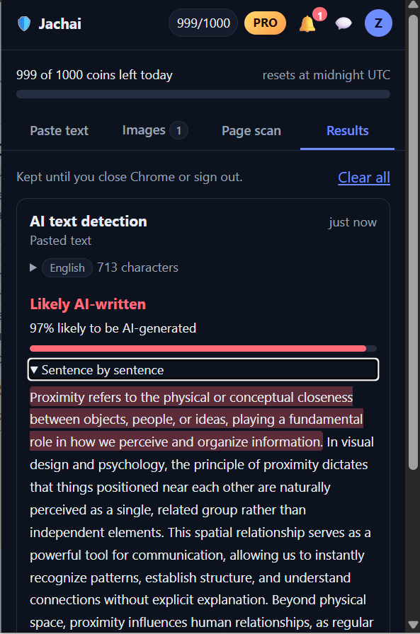<br><sub><b>AI-check</b><br>Overall score and per-sentence breakdown</sub></td>
    <td align="center" width="33%">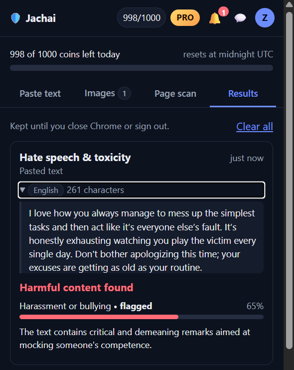<br><sub><b>Toxicity</b><br>Flagged categories with an explanation</sub></td>
    <td align="center" width="33%">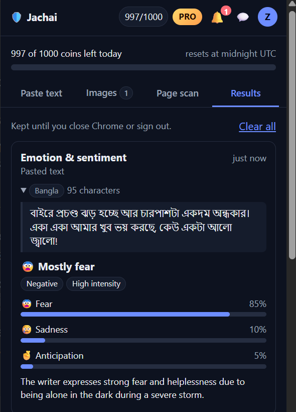<br><sub><b>Emotion</b><br>Works on Bangla text too</sub></td>
  </tr>
  <tr>
    <td align="center">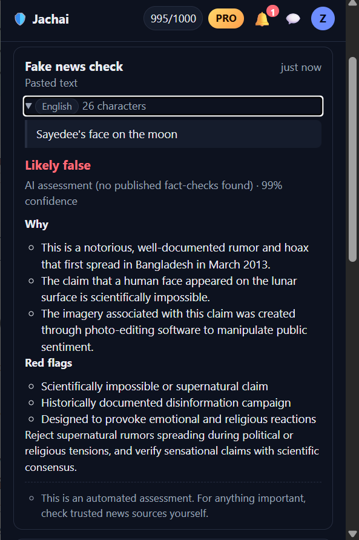<br><sub><b>Fact-check</b><br>Verdict, reasons and red flags</sub></td>
    <td align="center">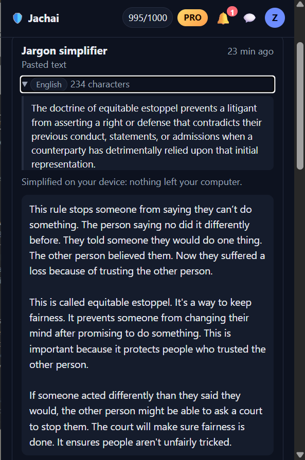<br><sub><b>Simplify</b><br>Private, on-device rewriting</sub></td>
    <td align="center">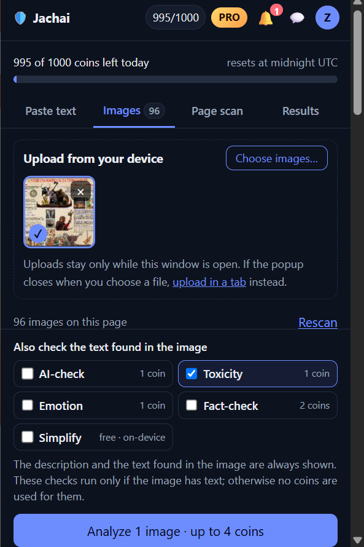<br><sub><b>Images</b><br>Upload, analyse and choose text checks</sub></td>
  </tr>
</table>

### Accounts, billing and feedback

<table>
  <tr>
    <td align="center" width="25%">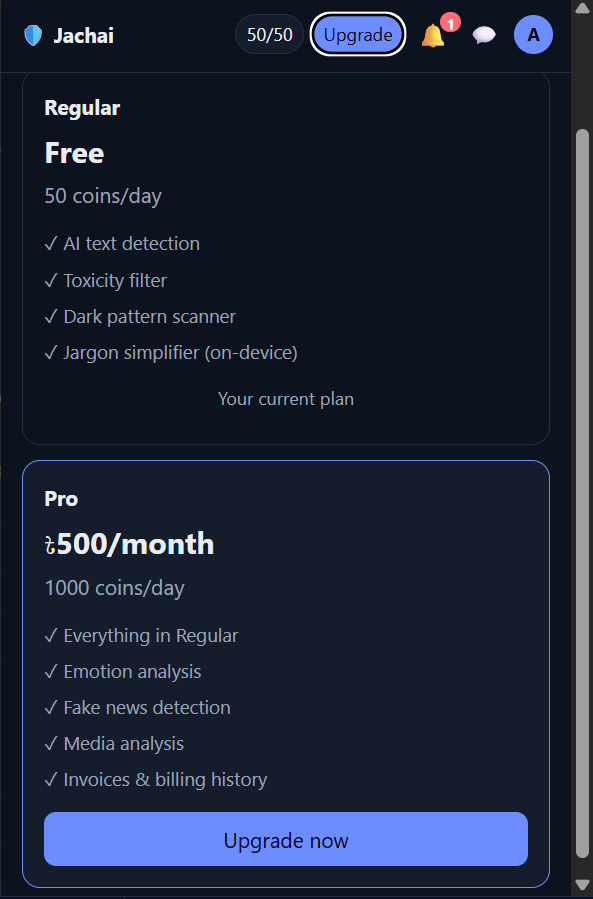<br><sub><b>Plans</b></sub></td>
    <td align="center" width="25%">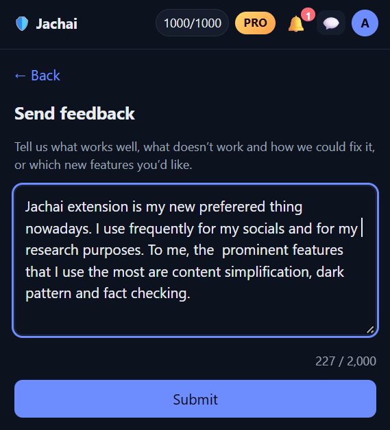<br><sub><b>Feedback</b></sub></td>
    <td align="center" width="25%">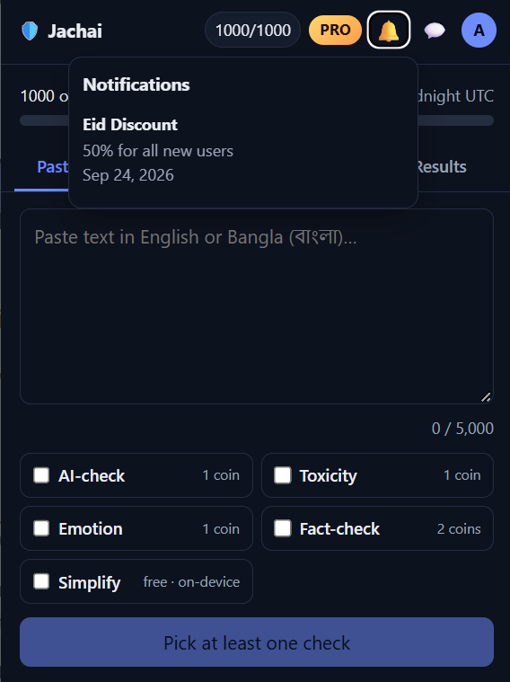<br><sub><b>Notifications</b></sub></td>
    <td align="center" width="25%">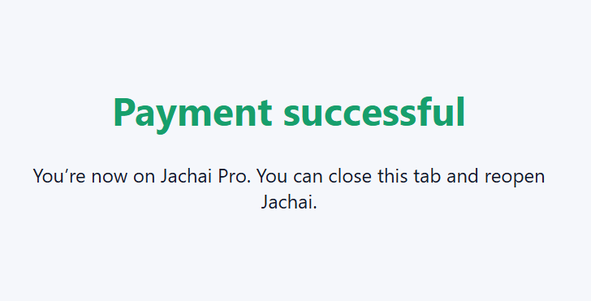<br><sub><b>Payment confirmation</b></sub></td>
  </tr>
</table>

### Admin portal

<table>
  <tr>
    <td align="center" width="50%">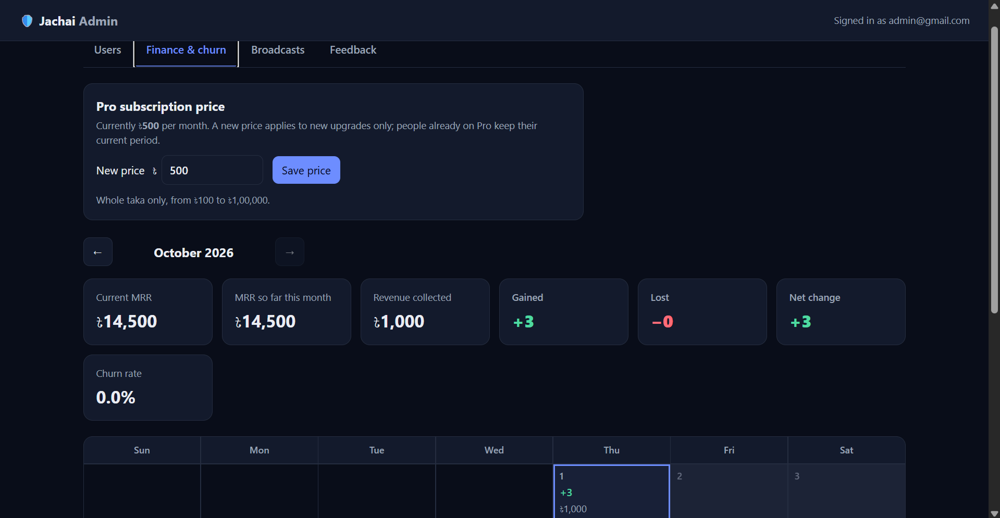<br><sub><b>Finance and churn</b><br>Editable Pro price, MRR and a monthly calendar</sub></td>
    <td align="center" width="50%">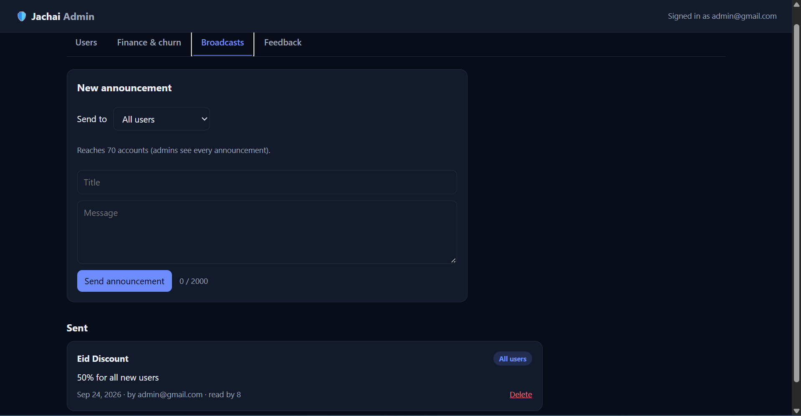<br><sub><b>Broadcasts</b><br>Announcements to all, Pro or Regular users</sub></td>
  </tr>
</table>

---

## Architecture

```
┌────────────────────────── Chrome extension (Manifest V3) ──────────────────────────┐
│  Popup UI  ──►  Background service worker  ──►  Content scripts (on the page)       │
│  tabs, results    message router, results,        blur, badges, cards,              │
│  profile, admin   context menu, alarms            dark-pattern scanner (local)      │
│                          │                                                          │
│                          │  Gemini Nano (on device) for free jargon simplification  │
└──────────────────────────┼──────────────────────────────────────────────────────────┘
                           │  HTTPS + JWT
                           ▼
┌──────────────────────── Node.js / Express API ──────────────────────────┐
│  auth · roles · coin metering · billing · admin · feedback · analyze    │
│                          │                                              │
│        SQLite (better-sqlite3)            AI providers                  │
│   users, usage, ledger, billing,     Sapling · Gemini · Google Fact     │
│   settings, feedback, broadcasts     Check Tools · Stripe               │
└──────────────────────────────────────────────────────────────────────────┘
```

Every server-side check follows the same six stages: input capture in the popup, client-side preparation, server-side validation, an atomic coin charge, a provider call with timeouts, retries and model fallback, and result storage and display. Validation happens before charging, so a malformed request never costs a coin, and any provider failure is refunded.

### Technology stack

| Layer | Technology |
|---|---|
| Extension | Chrome Manifest V3, vanilla JavaScript (ES modules), HTML and CSS. No framework, no build step, no third-party libraries |
| On-device AI | Chrome Prompt API with Gemini Nano |
| Backend | Node.js 20 or later, Express 4 |
| Database | SQLite through `better-sqlite3` |
| Authentication | JSON Web Tokens (HS256) with `bcryptjs` password hashing (cost 12) |
| Security middleware | `helmet`, `cors`, `express-rate-limit` |
| Billing | Stripe Checkout in test mode with inline BDT pricing, or a mock mode |
| Cloud AI | Sapling AI Detector, Gemini API, Google Fact Check Tools API |

---

## Getting started

### Prerequisites

- Node.js 20 or later
- A recent desktop Google Chrome. On-device Simplify needs Chrome's built-in Prompt API with Gemini Nano; where it is unavailable, you can use the cloud option instead
- API keys for the AI services you want to use (see [Configuration](#configuration)). A check whose key is missing reports "not set up yet" and costs nothing.
- Optional: a free [Stripe](https://dashboard.stripe.com/register) account for test-mode payments

### 1. Start the backend

```bash
cd backend
npm install
cp .env.example .env        # then edit .env (see Configuration below)
npm run seed:admin -- admin@example.com "Adm1n@pass"
npm run seed:demo           # optional: demo users and billing history for the admin portal
npm start                   # API on http://localhost:4000  (or `npm run dev` to auto-restart)
```

The admin password must follow the sign-up rules: 8 to 12 characters with an uppercase letter, a lowercase letter, a number and a special character, and no spaces. Wrap it in double quotes so your terminal does not treat symbols such as `!` or `&` specially.

### 2. Load the extension

1. Open `chrome://extensions` and switch on **Developer mode**.
2. Click **Load unpacked** and select the `extension/` folder.
3. Copy the extension's **ID** from its card on that page.
4. In `backend/.env`, set `EXTENSION_ORIGIN=chrome-extension://<your-extension-id>`, then restart the backend so CORS allows the extension.

The extension talks to `http://localhost:4000`. This address is set in `extension/shared/config.js` and in `host_permissions` in `extension/manifest.json`. Change both if you host the backend elsewhere.

### 3. Try it

1. Open the popup, sign up, and sign in.
2. Paste some text, tick a check, and press **Run**.
3. To see the admin portal, sign in with the admin account and click the **Admin** chip in the popup header.

---

## Configuration

All settings live in `backend/.env`. Copy `backend/.env.example` to get started. Never commit `.env`: it is listed in `.gitignore`.

| Variable | Required | Purpose |
|---|---|---|
| `JWT_SECRET` | Yes | At least 32 random characters. The server refuses to start otherwise |
| `EXTENSION_ORIGIN` | Yes | `chrome-extension://<id>`, so the extension may call the API |
| `PORT`, `PUBLIC_URL` | No | Defaults to `4000` and `http://localhost:4000` |
| `DB_PATH` | No | Location of the SQLite database file |
| `BILLING_MODE` | No | `mock` (default, instant upgrades) or `stripe` (test-mode checkout) |
| `STRIPE_SECRET_KEY` | In Stripe mode | A **test** key (`sk_test_...`). The server refuses to start with a live key |
| `STRIPE_WEBHOOK_SECRET` | No | Only needed if you also forward webhooks with the Stripe CLI |
| `PRO_PRICE_TAKA` | No | Starting Pro price in whole taka (default `500`). After the first start, the admin changes the price in the admin portal |
| `DAILY_LIMIT_REGULAR`, `DAILY_LIMIT_PAID` | No | Daily coins for Regular (default `50`) and Pro (default `1000`) |
| `SAPLING_API_KEY` | For AI-check | [Sapling](https://sapling.ai) API key |
| `GEMINI_API_KEY` | For most checks | [Google AI Studio](https://aistudio.google.com/apikey) key, used for toxicity, emotion, fact-check, images and the cloud simplifier |
| `GEMINI_MODEL`, `GEMINI_FALLBACK_MODELS` | No | Primary model and a comma-separated list of fallbacks |
| `FACTCHECK_API_KEY` | No | Google Fact Check Tools API key. Without it, fact-checks use the Gemini assessment only |

AI keys stay on the server and are never sent to the extension.

### Stripe test mode

1. Create a free Stripe account and make sure **Test mode** is on in the Dashboard.
2. Go to **Developers → API keys** and copy the secret key that starts with `sk_test_`.
3. In `backend/.env`, set `BILLING_MODE=stripe` and `STRIPE_SECRET_KEY=sk_test_...`, then restart the backend.
4. In the popup, click **Upgrade → Upgrade now**, and pay with a Stripe test card.

| Test card | Result |
|---|---|
| `4242 4242 4242 4242` | Payment succeeds |
| `4000 0000 0000 0002` | Card declined |
| `4000 0025 0000 3155` | Requires 3-D Secure |

Use any future expiry date and any CVC. No real money moves. Payment is confirmed when Stripe sends the buyer back to the return page, so webhooks are optional. To also receive webhooks locally, run `stripe listen --forward-to localhost:4000/billing/webhook` and put the `whsec_...` secret it prints into `STRIPE_WEBHOOK_SECRET`.

> Whether BDT is available as a payment currency depends on your Stripe account's country and settlement currency. If Stripe rejects it, the app shows an error instead of silently switching currency.

---

## Accounts, coins and billing

| Account | Daily coins | Notes |
|---|---|---|
| **Regular** (free) | 50 | AI-check, toxicity, dark-pattern scan, page toxicity scan, on-device Simplify |
| **Pro** | 1,000 | Everything in Regular, plus emotion, fact-check and image analysis, with invoices and billing history |
| **Admin** | Unlimited | Admin portal. Admins do not have a subscription or a Billing card |

- Allowances reset at **midnight UTC**, and the coin meter turns red when 10% or less is left.
- Each button shows its cost before you run it, for example **Run 3 checks · 3 coins**.
- Server-side limits: 5,000 characters per text check, 30 passages per page scan, and about 4 MB per image.
- The server owns roles, prices and costs. The extension only displays them.
- A new Pro price applies to **new** upgrades only. People already on Pro keep their current period.
- Amounts are stored in the smallest currency unit (poisha) and shown in taka.

---

## Security and privacy

- **No analysis without a user action.** Jachai only analyses content when you start a check. Analysed text is not stored on the server.
- **Server-held secrets.** AI keys stay in server environment variables. The server will not start in Stripe mode with a live key.
- **Hardened extension.** No remote code and no inline scripts, in line with the Manifest V3 content-security policy. All user and page-supplied text is escaped before it is rendered. On-page cards are drawn inside a Shadow DOM so a website cannot read or restyle them.
- **Authentication.** JWTs with a revocable `token_version`, bcrypt-hashed passwords, rate limiting, and a strong-password policy (8–12 characters with an uppercase letter, a lowercase letter, a number and a special character, and no spaces).
- **Local-first where possible.** The dark-pattern scanner and on-device Simplify never leave your computer.
- **Honest results.** Every result is shown as a hint, with its caveats stated.
- **Feedback privacy.** Feedback is saved with the sender's account, is visible only to admins, and is removed when the account is removed.

---

## Evaluation

All figures come from the project report. They are measured on small, team-built fixtures and are indicative, not general.

### Quality of the checks

| Component | Test set | Result |
|---|---|---|
| Dark-pattern scanner | 44-element labelled fixture | 86.2% precision and 86.2% recall, F1 0.862 |
| Language detector (script-based) | 30 sentences | 83.3% accuracy |

Cloud pipelines, evaluated zero-shot (no training or fine-tuning) on public benchmark data:

| Pipeline | Samples | Accuracy | F1 |
|---|---|---|---|
| AI text (English) | 80 | 96.3% | 0.96 |
| Toxicity (English) | 300 | 85.0% | 0.84 |
| Toxicity (Bangla) | 300 | 77.0% | 0.76 |
| Emotion | 70 | 77.1% | 0.75 |
| Fake news | 40 | 72.5% | 0.67 |

### Correctness and performance

- **54 of 54** automated functional and security tests passed, including 60 parallel requests against a 50-coin allowance (exactly 50 succeeded) and a test showing a refund is not lost when the provider call fails.
- Database-backed endpoints respond in about **1–2 ms** at the median on a local server. Login and sign-up take about 330 ms by design, because of bcrypt with cost 12.
- The dark-pattern scanner runs in **33–59 ms** on a synthetic page of 3,000 paragraphs.
- The unpacked extension is **216 KB** with no third-party libraries.

### User acceptance test (15 participants)

- Every participant completed their tasks: 11 without difficulty and 4 with difficulty.
- Mean ratings were between **3.9 and 4.5** out of 5, with overall ease of use at **4.53** and satisfaction at **4.47**.
- Net Promoter Score: **+53**.
- The most requested improvements were better Bangla support and fairer coin rules.

---

## Limitations

- **Third-party AI.** Five of the six pipelines depend on external models. Providers can change, and free-tier rate limits can reject requests at peak times. Fallback models and refunds soften this but do not remove it.
- **Detector reliability.** AI-text detectors can be fooled by paraphrasing and can be biased, and LLM toxicity judgements are less consistent on borderline cases. Treat results as hints.
- **Rule-based dark patterns.** The scanner only recognises wording in its rule set. It found 1 of 5 out-of-vocabulary examples and cannot judge purely visual tricks such as disguised ads or misleading button colours.
- **Chromium and desktop only.** The extension relies on Chrome's Manifest V3 and, for on-device Simplify, Chrome's built-in AI.
- **Mixed-language text.** The language detector classified only half of the mixed English and Bangla sentences correctly.
- **Password length cap.** The 12-character maximum is a project requirement. It rules out long passphrases and differs from current NIST guidance.
- **Evaluation scope.** Fixtures are small and written by the team, and the user test had 15 participants, all students.

---

## Project structure

```
Jachai/
├── extension/
│   ├── manifest.json            MV3 manifest and permissions
│   ├── background/              service worker, analysis flow, context menu, results, page tools
│   ├── content/                 overlay.js (cards, blur, badges), dark-patterns.js (scanner)
│   ├── popup/                   popup UI, on-device simplifier, device uploads
│   │   └── views/               auth, dashboard, profile, upgrade, feedback, tabs/
│   ├── admin/                   admin portal (users, finance, broadcasts, feedback)
│   └── shared/                  api client, config, messages, task table, formatting, password rules
├── backend/
│   ├── .env.example
│   └── src/
│       ├── server.js, config.js, db.js
│       ├── middleware/          JWT and role guards
│       ├── routes/              auth, me, billing, analyze, notifications, feedback, admin
│       ├── services/            analysis, quota, subscriptions, settings, password, safe-fetch
│       │   └── providers/       sapling, gemini, factcheck
│       └── scripts/             seed-admin, seed-demo, convert-usd-to-bdt
└── docs/images/                 README screenshots
```

---

## Roadmap

- Hybrid dark-pattern detection that adds a small text classifier to the rules
- On-device Bangla models for free, private Bangla checks
- Feedback analytics, so admins can tag and resolve feedback
- A more granular coin economy with per-task pricing, a shared free pool and AI cost reporting
- A first-run tour, a Bangla interface language and accessibility testing
- Content provenance (for example C2PA credentials) shown next to image analysis
- Production deployment on a managed HTTPS host with PostgreSQL

---

## Team

Jachai was designed and built by:

| Name |
|---|
| Abu Sadat Md. Istihad Bari |
| Zawad Ridwan |
| Tanveer Hasan |

**Supervisor:** Labib Hasan Khan, Lecturer, Department of Computer Science and Engineering, Brac University
|---|
**Co-supervisor:** Md. Aquib Azmain, Senior Lecturer, Department of Computer Science and Engineering, Brac University

Submitted in partial fulfilment of the requirements for the degree of B.Sc. in Computer Science and Engineering, Brac University, 2026.

---

## License

No open-source license has been selected for this repository yet, so all rights are reserved by default. If you would like to use or build on this work, please contact the authors.
